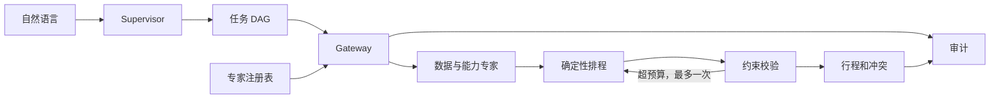

# 架构、专家注册与版本追溯

Supervisor 首先生成严格的 Intent，再生成条件任务图。目的地解析完成后，餐饮、景点、住宿、天气等满足依赖的任务可并行。住宿、天气和跨城节点取决于需求。网关将失败节点视为已结束，下游以已成功的结构化结果尝试降级。

候选记录公开匹配能力、地区、开关、依赖、输入输出契约、成本和历史可靠性分数。历史可靠性是当前服务进程的平滑成功率。活跃候选优先，版本参与排序。每个任务最多两次专家尝试，可激活候补。没有合适专家时生成 `capability_gap`。研究结果被保留以供后续排程和预算返工使用。

## 注册专家

使用 `travel.engine.Expert` 描述专家。在 `travel.experts.build_registry` 中注册，也可在自建 Registry 中通过 `register(expert)` 接入。已有能力的补充专家需接受 `TaskInput` 并返回该能力在 `CONTRACTS` 中的 Pydantic 类型。配置语义版本、支持的 ISO 国家代码或通配符、所需结果任务、超时和成本。设 `standby=True` 可作为候补。扩展全新任务类型时，还需要定义任务触发条件及输出契约。

`tests/test_system.py` 中的注册测试在同一 Gateway 运行期间注册 2.0.0 候补专家，验证无需改 Supervisor 即可发现新版本。东京、大阪示例展示内置的候补铁路专家激活。

## 版本与回放

每次执行以唯一 run ID 保存以下文件。

| 文件 | 内容 |
| --- | --- |
| `request.json` | 最小化结构化需求和上次 run ID |
| `manifest.json` | Git commit、源码哈希、工作树状态、构建号、依赖锁哈希、Supervisor 配置和专家版本 |
| `task_graph.json` | 依赖与任务能力 |
| `routing_trace.json` | 候选及其评分 |
| `events.jsonl` | 有序执行事件、专家版本、状态、结构化结果 |
| `evidence.json` | 实际传入规划流程的结构化数据快照及 SHA-256 |
| `final_plan.json` | 行程、冲突和缺口 |

Audit Replay 按记录顺序读取事件和原结果。Execution Replay 指重新调用模型或外部工具。本系统提供前者。重新提交需求是一次新执行，有新 run ID，外部数据和模型输出可能变化。API Key、认证头、自由文本和原始错误消息不写入审计。结构化的出行安排可能包含个人信息，使用时应控制本地目录访问。
